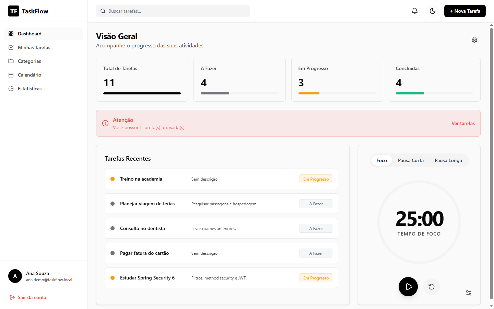
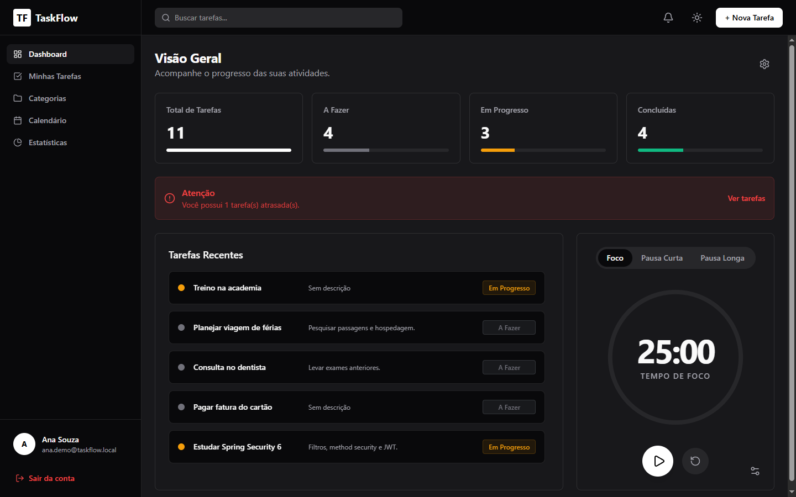
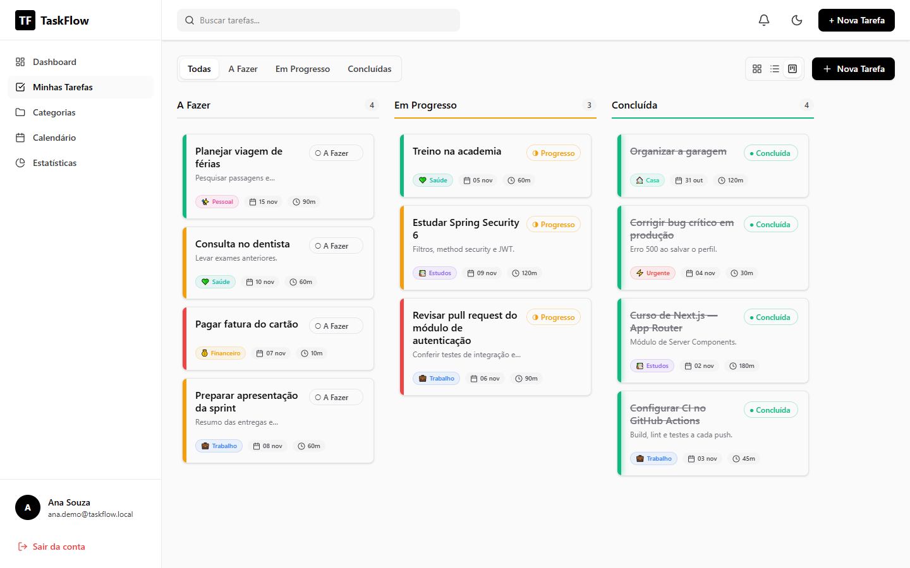
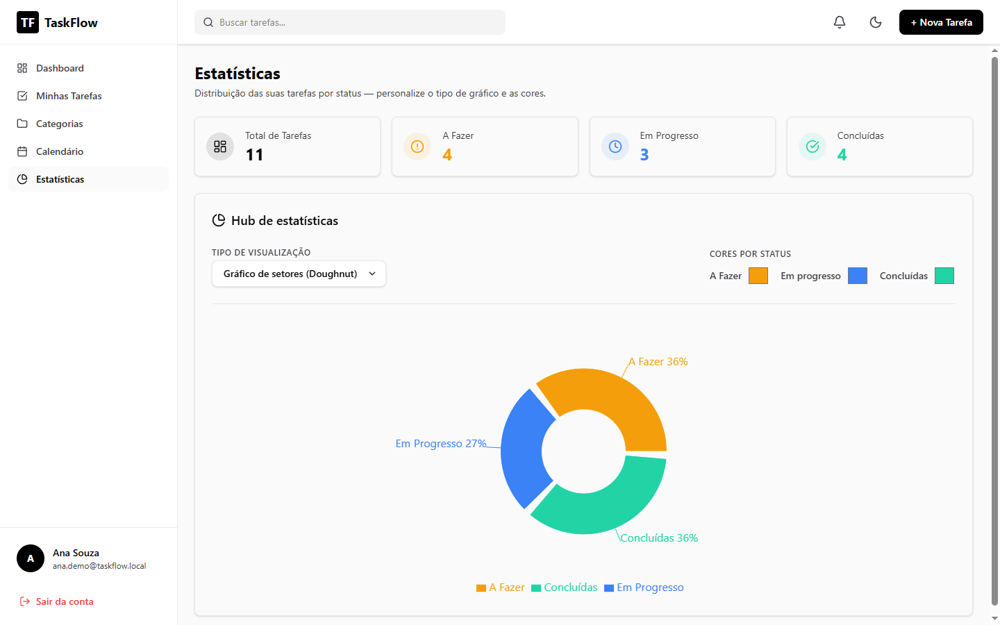
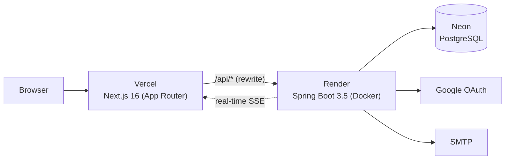

# ⬡ TaskFlow

[](https://github.com/Thg1zZ/TaskFlowProject/actions/workflows/ci.yml)


[](LICENSE)

[Português](README.md) | **English**

Full-stack task manager with a Kanban board, real-time collaboration and a strong focus on security: JWT authentication in an httpOnly cookie, Google sign-in, rate limiting behind proxies, session invalidation and integration tests against a real PostgreSQL database.

🔗 **Live demo:** [task-manager-with-login.vercel.app](https://task-manager-with-login.vercel.app) (switch to English with the PT/EN selector)
> The backend runs on Render's free tier and sleeps when idle: the first request may take up to a minute.



## Features

- **Kanban board** with drag and drop across *To do*, *In progress* and *Done*
- **Subtask** checklists with a progress bar, **tags** and **combined filters** (priority, category, tag and due date)
- **Recurring tasks** (daily, weekly or monthly): completing one creates the next occurrence automatically
- **Portuguese and English UI**, including API messages
- **Calendar** and **statistics** with productivity charts
- Custom **categories** with color and icon
- **Real-time collaboration** (SSE): invite links with viewer, editor and admin roles
- **Notifications**, built-in **Pomodoro** timer and first-access **onboarding tour**
- **Profile** with avatar cropping, password change, account deletion and personal data download (LGPD)
- **Admin panel** with an audit log of every action
- **Light and dark themes** with customizable colors
- **Google sign-in** and password recovery by email

| Dark theme | Kanban | Statistics |
|---|---|---|
|  |  |  |

## Architecture



The frontend calls the API on its own domain (`/api/*`), which Vercel rewrites to the backend. This keeps the session cookie *first-party*, `httpOnly` and `SameSite=Strict`, so the token is never exposed to JavaScript.

## Security

| Area | Implementation |
|---|---|
| Session | JWT (HS256) in an `httpOnly`, `Secure`, `SameSite=Strict` cookie; revocation by `jti` on logout |
| Passwords | BCrypt (cost 12) and a complexity policy |
| Invalidation | Changing or resetting the password revokes **every** open session |
| Account takeover | The first Google sign-in on an unverified account discards the previous password and sessions |
| Authorization | Per-resource rules (`@PreAuthorize`) for owner, editor and viewer; 404 without revealing whether a resource exists |
| Rate limiting | By real client IP behind Cloudflare and Vercel, on login, sign-up, password recovery and admin routes |
| Password recovery | 256-bit token stored only as a SHA-256 hash, 30-minute validity, single use and one request per email every 15 minutes |
| Admin | `USER < ADMIN < SUPER_ADMIN` hierarchy and an audit log of every action that cannot be edited through the API |
| Data | Versioned migrations (Flyway), `ddl-auto=validate` and DTOs without sensitive data |
| Privacy (LGPD) | [Public policy](https://task-manager-with-login.vercel.app/privacidade) with legal bases and controller, consent also recorded for Google sign-in, IPs stored only as an HMAC, access logs purged after 180 days, audit log anonymized on account deletion and purged after 2 years, email hash of deleted accounts kept for 2 years and full data export as JSON |

## Tech stack

| Layer | Technologies |
|---|---|
| Frontend | Next.js 16, React 19, TypeScript, Tailwind CSS 4, SWR, Recharts, @hello-pangea/dnd |
| Backend | Java 17, Spring Boot 3.5, Spring Security 6.5, Spring Data JPA (Hibernate 6.6), Flyway 11, JJWT |
| Database | PostgreSQL (Neon) |
| Tests | JUnit 5, Mockito, Testcontainers, MockMvc, Playwright |
| Infrastructure | Docker, Render (health check via Spring Actuator), Vercel, GitHub Actions |

## Running locally

**Requirements:** Java 17, Maven, Node.js 20 and Docker.

**1. Database**
```bash
docker run -d --name taskflow-db -e POSTGRES_PASSWORD=postgres -e POSTGRES_DB=taskmanager -p 5432:5432 postgres:15-alpine
```

**2. Backend** (port 8080; migrations run automatically)
```bash
cd backend
export DB_URL=jdbc:postgresql://localhost:5432/taskmanager DB_USER=postgres DB_PASSWORD=postgres
export JWT_SECRET=$(openssl rand -base64 48) COOKIE_SECURE=false
export FRONTEND_URL=http://localhost:3000 CORS_ORIGINS=http://localhost:3000
mvn spring-boot:run
```

**3. Frontend** (port 3000)
```bash
cd frontend
npm ci
API_URL=http://localhost:8080/api npm run dev
```

Open `http://localhost:3000` and create an account. Every variable is documented in [`.env.example`](.env.example). Google sign-in and email delivery are optional for local development.

## Tests

```bash
cd backend
mvn verify
```

- **Unit:** client IP resolution behind proxies and secure Google account linking
- **Integration:** boot the whole application against a containerized PostgreSQL (Testcontainers) and cover 401/403, IDOR, session invalidation, password recovery, data exposure, LGPD, subtasks, recurrence and message language. They are skipped automatically when Docker is not available.

**End-to-end (Playwright):** with the database and backend running (steps 1 and 2 above), Playwright builds the frontend and drives the app in a browser: sign-up, onboarding tour, logout, wrong password, tasks with tags and subtasks, filters, recurrence, language switching and the LGPD export.
```bash
cd frontend
npx playwright install chromium
API_URL=http://localhost:8080/api npm run test:e2e
```
> Each run creates 2 accounts and sign-up allows 5 per hour per IP. Restart the backend to run it more often.

[CI](.github/workflows/ci.yml) runs the backend tests and the frontend lint and build, then the E2E suite against a PostgreSQL service container, on every push.

## Project structure

```
backend/   Spring Boot API (controller → service → repository) and Flyway migrations
frontend/  Next.js App Router: pages, components, hooks, API clients and translations (src/i18n)
frontend/e2e/  Playwright end-to-end tests
```

## License

Released under the [MIT](LICENSE) license.

---

Built by **Thiago Gomes** · [LinkedIn](https://www.linkedin.com/in/thiago-gomes-fc)
