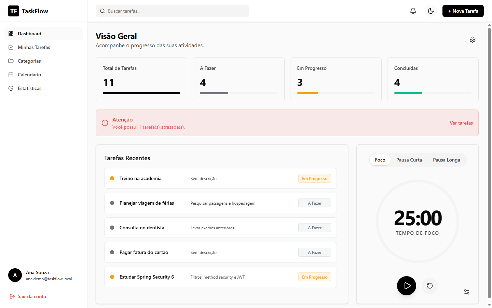
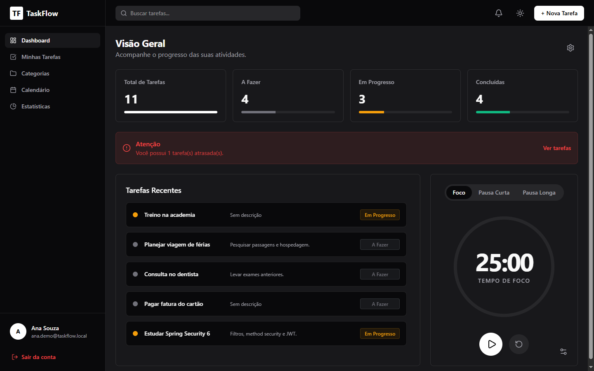
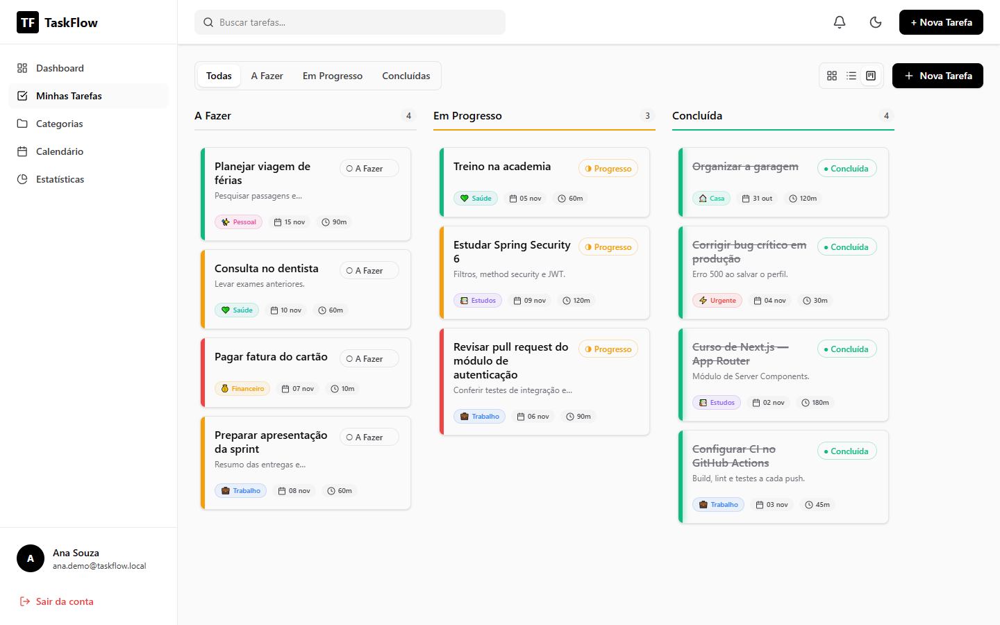
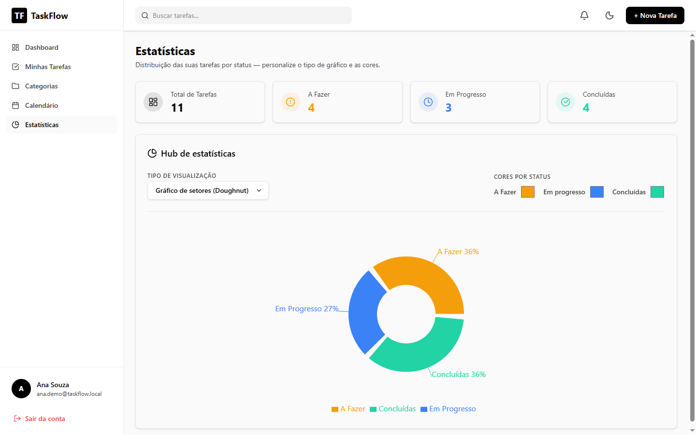
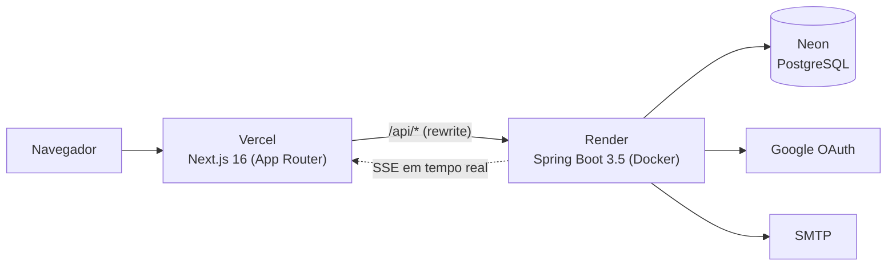

# ⬡ TaskFlow

[](https://github.com/Thg1zZ/TaskManegerProject/actions/workflows/ci.yml)


[](LICENSE)

**Português** | [English](README.en.md)

Gerenciador de tarefas full stack com Kanban, colaboração em tempo real e foco em segurança: autenticação JWT em cookie httpOnly, login com Google, rate limiting atrás de proxy, invalidação de sessões e testes de integração contra um PostgreSQL real.

🔗 **Demo:** [task-manager-with-login.vercel.app](https://task-manager-with-login.vercel.app)
> O backend roda no plano gratuito do Render e hiberna sem uso: a primeira requisição pode levar até 1 minuto.



## Funcionalidades

- **Kanban** com arrastar e soltar entre *A fazer*, *Em andamento* e *Concluído*
- **Calendário** e **estatísticas** com gráficos de produtividade
- **Categorias** personalizadas com cor e ícone
- **Colaboração em tempo real** (SSE): convite por link com papéis de leitor, editor e administrador
- **Notificações**, **Pomodoro** integrado e **tutorial** de primeiro acesso
- **Perfil** com recorte de avatar, troca de senha e exclusão de conta
- **Painel administrativo** com auditoria de ações
- **Tema claro e escuro** com cores personalizáveis
- **Login com Google** e recuperação de senha por e-mail

| Tema escuro | Kanban | Estatísticas |
|---|---|---|
|  |  |  |

## Arquitetura



O frontend chama a API pelo mesmo domínio (`/api/*`), reescrito pela Vercel para o backend. Assim o cookie de sessão é *first-party*, `httpOnly` e `SameSite=Strict`, sem expor o token ao JavaScript.

## Segurança

| Área | Implementação |
|---|---|
| Sessão | JWT (HS256) em cookie `httpOnly`, `Secure` e `SameSite=Strict`; revogação por `jti` no logout |
| Senhas | BCrypt (custo 12) e política de complexidade |
| Invalidação | Trocar ou redefinir a senha derruba **todas** as sessões abertas |
| Sequestro de conta | O primeiro login com Google numa conta não verificada descarta a senha e as sessões anteriores |
| Autorização | Regras por recurso (`@PreAuthorize`) para dono, editor e leitor; 404 sem revelar se o recurso existe |
| Rate limiting | Por IP real atrás de Cloudflare e Vercel, em login, cadastro, recuperação de senha e rotas de admin |
| Recuperação de senha | Token de 256 bits guardado só como hash SHA-256, validade de 30 min, uso único e 1 pedido por e-mail a cada 15 min |
| Admin | Hierarquia `USER < ADMIN < SUPER_ADMIN` e auditoria imutável de todas as ações |
| Dados | Migrations versionadas (Flyway), `ddl-auto=validate`, DTOs sem dados sensíveis e IP armazenado só como hash |

## Stack

| Camada | Tecnologias |
|---|---|
| Frontend | Next.js 16, React 19, TypeScript, Tailwind CSS 4, SWR, Recharts, @hello-pangea/dnd |
| Backend | Java 17, Spring Boot 3.5, Spring Security 6.5, Spring Data JPA (Hibernate 6.6), Flyway 11, JJWT |
| Banco | PostgreSQL (Neon) |
| Testes | JUnit 5, Mockito, Testcontainers, MockMvc |
| Infra | Docker, Render, Vercel, GitHub Actions |

## Rodando localmente

**Pré-requisitos:** Java 17, Maven, Node.js 20 e Docker.

**1. Banco de dados**
```bash
docker run -d --name taskflow-db -e POSTGRES_PASSWORD=postgres -e POSTGRES_DB=taskmanager -p 5432:5432 postgres:15-alpine
```

**2. Backend** (porta 8080; as migrations rodam sozinhas)
```bash
cd backend
export DB_URL=jdbc:postgresql://localhost:5432/taskmanager DB_USER=postgres DB_PASSWORD=postgres
export JWT_SECRET=$(openssl rand -base64 48) COOKIE_SECURE=false
export FRONTEND_URL=http://localhost:3000 CORS_ORIGINS=http://localhost:3000
mvn spring-boot:run
```

**3. Frontend** (porta 3000)
```bash
cd frontend
npm ci
API_URL=http://localhost:8080/api npm run dev
```

Acesse `http://localhost:3000` e crie uma conta. Todas as variáveis estão documentadas em [`.env.example`](.env.example). O login com Google e o envio de e-mail são opcionais localmente.

## Testes

```bash
cd backend
mvn verify
```

- **Unitários:** extração de IP atrás de proxy e vínculo seguro de contas Google
- **Integração:** sobem a aplicação inteira contra um PostgreSQL em container (Testcontainers) e cobrem 401/403, IDOR, invalidação de sessões, recuperação de senha e exposição de dados. São pulados automaticamente se não houver Docker.

O [CI](.github/workflows/ci.yml) roda os testes do backend e o lint e o build do frontend a cada push.

## Estrutura

```
backend/   API Spring Boot (controller → service → repository) e migrations Flyway
frontend/  Next.js App Router: páginas, componentes, hooks e clientes da API
```

## Licença

Distribuído sob a licença [MIT](LICENSE).

---

Desenvolvido por **Thiago Gomes** · [LinkedIn](https://www.linkedin.com/in/thiago-gomes-fc)
